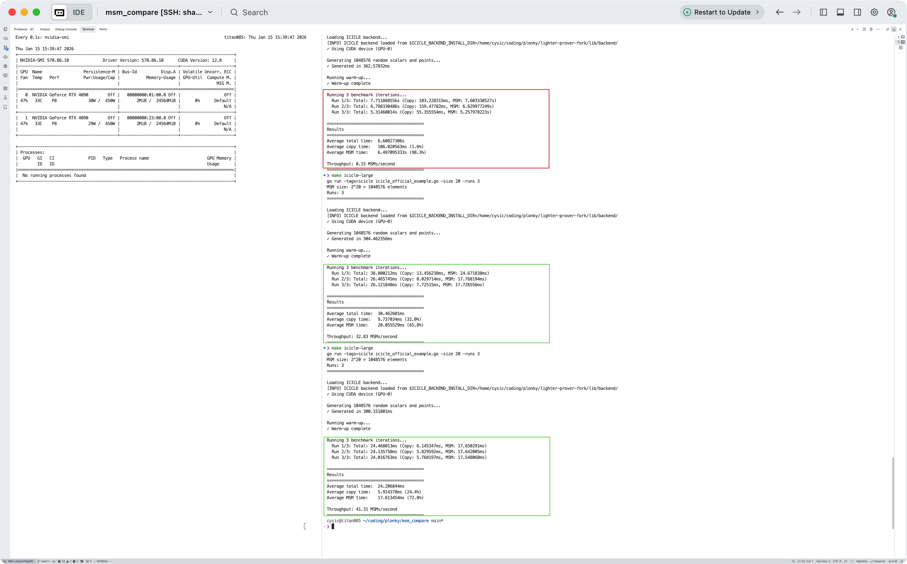

# ICICLE MSM Benchmark

Benchmarking tool comparing ICICLE v2 vs v3 GPU MSM performance on the BN254 elliptic curve.

## Key Finding: ICICLE v3 has severe timing instability

For $2^{20}$ elements on RTX 4090:

| Version | Typical MSM | Worst Case | Variation |
|---------|-------------|------------|-----------|
| **ICICLE v2** | 17-20ms | ~160ms | ~8x |
| **ICICLE v3** | 20ms | 6-9 seconds | 300-400x |

**Recommendation: Use ICICLE v2** for stable, predictable performance.



## ICICLE v3 Problem

The v3 GPU MSM time is highly unstable due to low GPU utilization (~17% SM usage) causing random power state switching:
- **P0 state (2520 MHz)**: Fast runs (~20ms)
- **P5 state (1400-1700 MHz)**: Slow runs (6-9 seconds)

See `GPU_TIMING_ANALYSIS.md` for detailed investigation.

## ICICLE v3 Instability Investigation

We tested multiple solutions to stabilize ICICLE v3 MSM timing:

| # | Solution | Status | Result |
|---|----------|--------|--------|
| 1 | Lock GPU clocks via nvidia-smi | FAILED | Still 5-6s even with clocks locked at max |
| 2 | CUDA Exclusive Process Mode | PARTIAL | Improved to 17-100ms but not stable |
| 3 | MSM Config tuning (C=10) | PARTIAL | 48-199ms (~4x variance vs 300x default) |
| 4 | GPU warmup kernel before MSM | FAILED | Made it consistently slow (5-6s) |
| 5 | Persistent GPU kernel | SKIPPED | Same approach as warmup |
| 6 | Async stream priority | SKIPPED | Not exposed in ICICLE v3 API |
| 7 | CUDA MPS (Multi-Process Service) | FAILED | Still 6-7s with MPS enabled |
| 8 | **Upgrade to ICICLE v3.9.2** | **BEST v3** | **16-350ms** (10x better than v3.2.2) |

### Why ICICLE v2 is Stable

| Aspect | ICICLE v2 | ICICLE v3 |
|--------|-----------|-----------|
| CUDA access | Direct runtime (`libcudart`) | Backend abstraction layer |
| Library count | 2 libs | 6 libs |
| Backend loading | Compile-time | Runtime dynamic loading |
| MSM time (2^20) | **17-20ms stable** | 20ms-6s unstable |
| Variance | ~8x | ~300x |

The v3 backend abstraction layer (`runtime.LoadBackendFromEnvOrDefault()`) introduces timing instability that cannot be fixed from the application side.

### Recommended Solutions

**Option 1: Use ICICLE v2 (Most Stable)**
```bash
make icicle-v2-large  # Stable ~18ms MSM
```

**Option 2: Upgrade to ICICLE v3.9.2**
- Reduces variance from 300x to ~20x (16-350ms)
- Requires license server connection
- Build from source or use prebuilt backend libs

**Option 3: Use v3.2.2 with C=10 config**
```go
cfg := core.GetDefaultMSMConfig()
cfg.C = 10  // Set window bitsize
```
- Reduces variance from 300x to ~4x

## Quick Start

### ICICLE v2 (Recommended)

```bash
make icicle-v2-large  # Run v2 MSM benchmark (2^20 elements)
```

### ICICLE v3

```bash
make lib              # Download v3 libraries (first time only)
make icicle-large     # Run v3 MSM benchmark (2^20 elements)
```

## Benchmark Results

### ICICLE v2 (Stable)

```
MSM size: 2^20 = 1048576 elements
  Run 1/5: Total: 25.6ms (Copy: 6.1ms, MSM: 17.9ms)
  Run 2/5: Total: 25.8ms (Copy: 6.4ms, MSM: 18.0ms)
  Run 3/5: Total: 25.8ms (Copy: 6.4ms, MSM: 17.9ms)
  Run 4/5: Total: 104.6ms (Copy: 6.7ms, MSM: 27.6ms)
  Run 5/5: Total: 100.4ms (Copy: 82.1ms, MSM: 16.9ms)

Average MSM time: ~19ms
```

### ICICLE v3 (Unstable)

```
MSM size: 2^20 = 1048576 elements
  Run 1/3: Total: 9.35s (Copy: 77ms, MSM: 9.27s)   <- SLOW
  Run 2/3: Total: 7.09s (Copy: 92ms, MSM: 7.00s)   <- SLOW
  Run 3/3: Total: 7.22s (Copy: 111ms, MSM: 7.10s)  <- SLOW
```

Sometimes v3 is fast (~20ms), but it's unpredictable.

## CPU vs GPU (v3)

When v3 GPU is slow, CPU is significantly faster:

| Degree | Size    | CPU Time  | GPU Time | Result |
|--------|---------|-----------|----------|--------|
| 2^18   | 262144  | 29.00 ms  | 2.79 s   | 93x CPU faster |
| 2^19   | 524288  | 66.00 ms  | 3.83 s   | 57x CPU faster |
| 2^20   | 1048576 | 100.00 ms | 7.35 s   | 73x CPU faster |

## All Make Targets

```bash
# Setup
make lib               # Download ICICLE v3 libraries
make clean             # Clear Go build cache

# ICICLE v2 (stable - recommended)
make icicle-v2-small   # v2 MSM 2^7 = 128 elements
make icicle-v2-medium  # v2 MSM 2^15 = 32K elements
make icicle-v2-large   # v2 MSM 2^20 = 1M elements

# ICICLE v3 (unstable)
make icicle-small      # v3 MSM 2^7 = 128 elements
make icicle-medium     # v3 MSM 2^15 = 32K elements
make icicle-large      # v3 MSM 2^20 = 1M elements

# CPU vs GPU comparison
make compare           # CPU vs GPU (v3)
```

## Hardware

- GPU: NVIDIA GeForce RTX 4090
- CPU: AMD EPYC 7773X 64-Core Processor
- CUDA: 12.8
- Go: 1.24.9 linux/amd64
- GCC: 13.3.0
